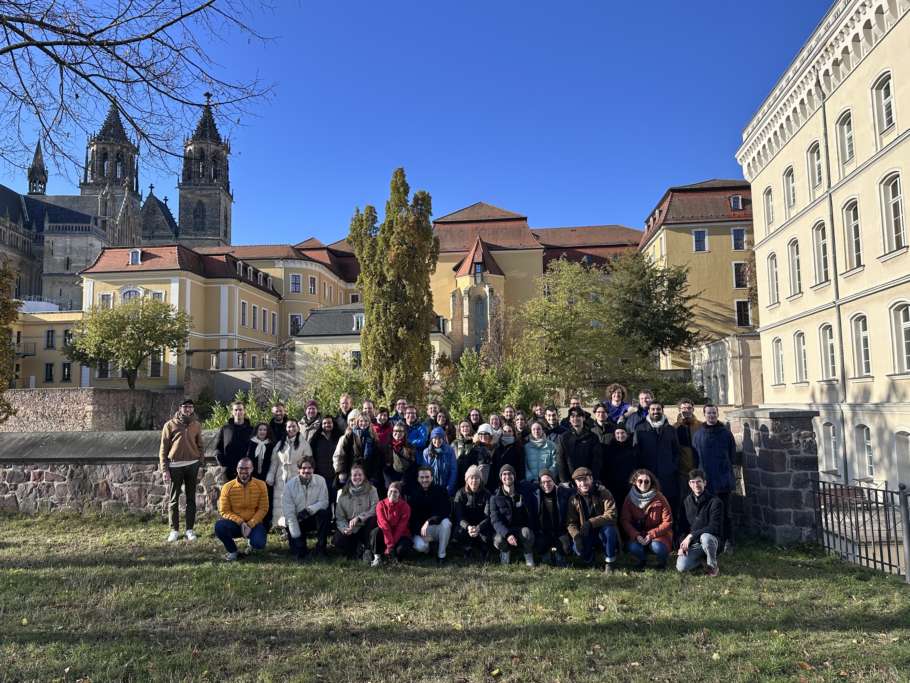

I attended the Herbstforum für Promovierende (Autumn Forum for Doctoral Researchers) of the Studienstiftung des deutschen Volkes, held in Magdeburg, Germany, from November 12 to 16.

Through the panel discussion and the oral presentations, I had the chance to learn about research in a wide range of fields.

Thank you to everyone I met and talked with.

#Studienstiftung

<figure>
  
  <figcaption>
    Oral presentation
  </figcaption>
</figure>

<figure>
  
  <figcaption>
    Group photo
  </figcaption>
</figure>
