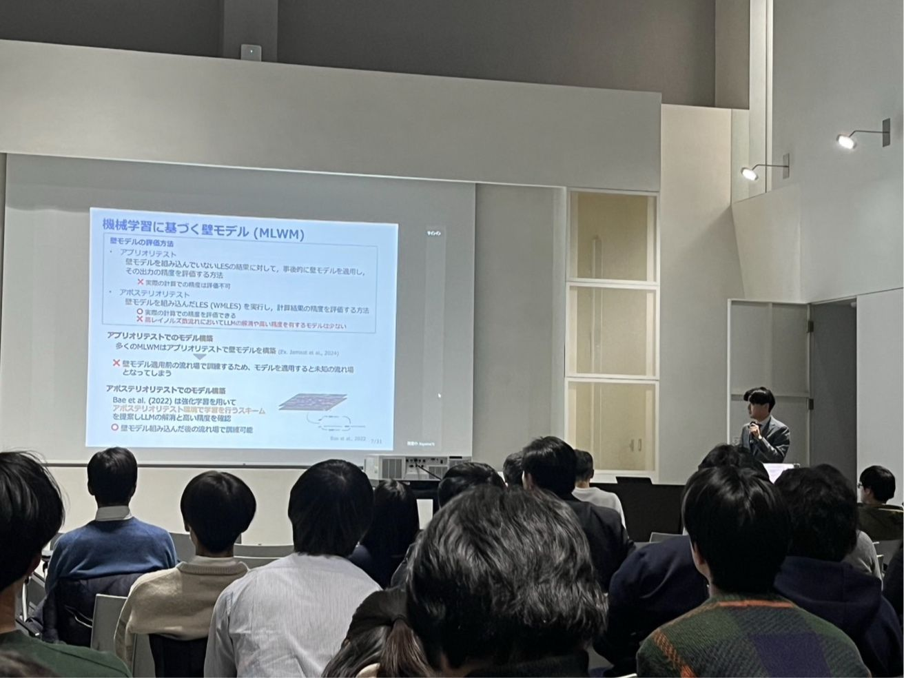

私は、11月12日から16日にドイツのMagdeburgで開かれたStudienstiftung des deutschen VolkesのHerbstforum für Promovierende
（英語訳も）に参加しました。

パネルディスカッションやオーラルプレゼンテーションを通して、様々な領域の研究について学ぶことができました。

交流した皆様ありがとうございました。
I am pleased to share two recent oral presentations based on my master’s research on integrating machine learning with fluid dynamics!!

In December 2024, I presented at the 38th CFD Symposium in Tokyo:
“Development of Wall Model for Large Eddy Simulation Using Generative Adversarial Networks”

In March 2025, I delivered a talk at the 40th IIS-TSFD Symposium & 37th Inter-Institutional Joint Serminar on Turbulent Flow Control, also in Tokyo:
“Application of GANs to the Development of Wall Models for LES and Evaluation of Their Predictive Performance”

I was honored to receive the Outstanding Presentation Award at 37th Inter-Institutional Joint Serminar on Turbulent Flow Control.

Many thanks to my collaborators and supervisors for their continued guidance and support.

#FluidDynamics #CFD #MachineLearning #LES #WallModeling #GAN

<figure>
  
  <figcaption>
    口頭発表
  </figcaption>
</figure>

<figure>
  
  <figcaption>
    集合写真
  </figcaption>
</figure>
